# SparseDiff

SparseDiff is a conditional diffusion model for demosaicing Bayer (GBRG) and Sparse RGBW color filter arrays. The four checkpoints use the same JiT-B/16 architecture with CFA-specific conditioning and a lightweight residual encoder. Bayer and Sparse weights are not interchangeable.

## Installation

Use Python 3.12. Install the PyTorch 2.9.1 and torchvision 0.24.1 builds for your platform, then run `python -m pip install -r requirements.txt` from the repository root. For CUDA installation options, see [PyTorch](https://pytorch.org/get-started/locally/).

## Models

Download the four inference checkpoints from [Funct1ons/SparseDiff on Hugging Face](https://huggingface.co/Funct1ons/SparseDiff). The weights are hosted there, not in this Git repository.

| Checkpoint config | Training light | Epochs | Optimizer steps | Weights |
|---|---|---:|---:|---|
| [`bayer_normal`](models/bayer_normal.json) | Normal | 100 | 563,400 | [Download](https://huggingface.co/Funct1ons/SparseDiff/resolve/main/bayer_normal/model.safetensors) |
| [`sparse_normal`](models/sparse_normal.json) | Normal | 100 | 563,400 | [Download](https://huggingface.co/Funct1ons/SparseDiff/resolve/main/sparse_normal/model.safetensors) |
| [`bayer_mixed`](models/bayer_mixed.json) | Normal + simulated low light | 100 | 563,400 | [Download](https://huggingface.co/Funct1ons/SparseDiff/resolve/main/bayer_mixed/model.safetensors) |
| [`sparse_mixed`](models/sparse_mixed.json) | Normal + simulated low light | 100 | 563,400 | [Download](https://huggingface.co/Funct1ons/SparseDiff/resolve/main/sparse_mixed/model.safetensors) |

To download one checkpoint to the path used in the examples below, install the Hugging Face CLI and run:

```bash
python -m pip install -U huggingface_hub
hf download Funct1ons/SparseDiff bayer_normal/model.safetensors --local-dir weights
```

Replace `bayer_normal` with the checkpoint you need. All four files together are about 2.61 GB. See [SHA-256 checksums](models/checksums.sha256); the pipeline checks the selected file before loading. These are inference weights, not training-resume checkpoints. Both mixed checkpoints used a low-light sampling probability of 0.8. The code's MIT license does not cover the weights.

## Image pipeline

Run commands from the repository root. `simulate` and `mosaic` do not need weights. For `restore`, `demo` and `benchmark`, download the checkpoint separately and pass its `model.safetensors` explicitly. The examples below use `weights/<checkpoint>/model.safetensors`; any location works. The CLI checks the file against the selected model's release checksum and never downloads weights automatically. `python -m pipelines --help` lists the commands; add `--help` after a command for its options.

| Command | Input | Writes to `--output` |
|---|---|---|
| `simulate` | RGB + CFA + illumination | `input.png`, `simulated_rgb.png`, and `simulation.npy` + `simulation.json`. Sparse adds `input_w.png` and `simulated_w.png`. |
| `mosaic` | RGB + CFA, or a `simulate` output directory | `observation.npy` + `observation.json`, `cfa_rgb.png`, `cfa_rgb_mask.png`. Sparse adds `cfa_w.png` and `cfa_w_mask.png`. When starting from RGB, also writes the simulation outputs. |
| `restore` | The observation pair from `mosaic` or `demo`, plus weights | `restored.png` and `run.json` with the settings and hashes. No original RGB image is needed. |
| `demo` | RGB + weights; CFA is selected by the model | All simulation, observation, preview and restoration files in one directory. |
| `benchmark` | [RGB image directory](#benchmark) + weights | `ground_truth/` and `manifest.json`, `predictions/` with restored RGB PNGs and `predictions.json`, and `metrics.json`. |

Use a **new** output directory for each command. For single-image RGB input (`simulate`, `mosaic`, or `demo`), pass **one** of `--sample 1`, `--sample 2`, or `--image path/to/input.png`. Use an 8-bit RGB image in sRGB, exactly 256×256, or use `--crop X Y` to select a 256×256 patch from a larger image (zero-based top-left, after EXIF orientation). Nothing is resized or stitched. No camera RAW decoding is performed. Sparse simulation derives 8-bit Lab L with Pillow/LittleCMS for the W sites.

`--light-level` defaults to `1` (normal). The other supported values are `1/30`, `1/40`, `1/50`, `1/80`, `1/100` and `1/150` (or their floating-point equivalents). Use a mixed model for low light. Bayer degrades RGB before sampling the GBRG mosaic; Sparse samples RGB and Lab L first, then degrades both planes at the same light level with independent noise and a 3× W sensitivity. The original RGB comparison image is unchanged.

### Run the bundled examples

Each command below produces one of the results shown in the gallery. Omit `--device cuda:0 --precision bf16` for CPU/FP32. The default sampler is Euler 30, CFG 0, seed 42, with full-strength final projection in normal light and no effective projection in low light. Outputs are rounded to 8-bit RGB. Exact pixels can differ across PyTorch builds and devices.

```bash
python -m pipelines demo --sample 1 --model bayer_normal --weights weights/bayer_normal/model.safetensors --device cuda:0 --precision bf16 --output outputs/bayer_normal
python -m pipelines demo --sample 1 --model sparse_normal --weights weights/sparse_normal/model.safetensors --device cuda:0 --precision bf16 --output outputs/sparse_normal
python -m pipelines demo --sample 2 --light-level 1/40 --model bayer_mixed --weights weights/bayer_mixed/model.safetensors --device cuda:0 --precision bf16 --output outputs/bayer_mixed
python -m pipelines demo --sample 2 --light-level 1/40 --model sparse_mixed --weights weights/sparse_mixed/model.safetensors --device cuda:0 --precision bf16 --output outputs/sparse_mixed
```

### Use the steps separately

This sequence reproduces the Sparse low-light demo above. `mosaic` reads the simulation's light level and seed; `restore` reads the observation as-is and does not add new degradation or require ground truth.

```bash
python -m pipelines simulate --sample 2 --cfa sparse --light-level 1/40 --output outputs/simulated
python -m pipelines mosaic --simulated outputs/simulated --output outputs/observation
python -m pipelines restore --observation outputs/observation --model sparse_mixed --weights weights/sparse_mixed/model.safetensors --device cuda:0 --precision bf16 --output outputs/restored
```

Or create a Bayer observation directly from your own RGB image, without running a model:

```bash
python -m pipelines mosaic --image my_photo.png --crop 40 80 --cfa bayer --output outputs/my_bayer
```

Keep each `.npy` with its companion `.json`. `simulation.npy` stores float32 CHW values in `[0, 1]` (dense RGB for Bayer, degraded sampled RGBW for Sparse). `observation.npy` stores the model's normalized float32 CHW input in `[-1, 1]` (RGB for Bayer, RGBW for Sparse). The PNGs are **previews, not model inputs**: `simulated_*.png` show the actual low brightness, and `cfa_*.png` visualize the sampled sites with display gain in low light. The mask PNGs distinguish unsampled sites from sampled dark pixels.

### Sample inputs and real checkpoint outputs

The repository includes two original procedurally drawn samples: [a color and fine-detail chart](examples/samples/sample1.png) and [a landscape illustration](examples/samples/sample2.png). The restoration PNGs below are the actual output of the four release-weight files on an NVIDIA L40 at BF16, not mockups or interpolated baseline outputs. Click a PNG to inspect the individual CFA pixels.

| Checkpoint / illumination | Original RGB | CFA RGB preview | CFA W preview | Restored RGB |
|---|---|---|---|---|
| [`bayer_normal`](examples/demo_results/bayer_normal/run.json), normal | 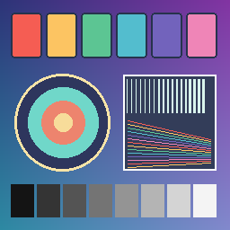 | 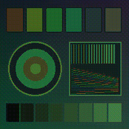 | — | 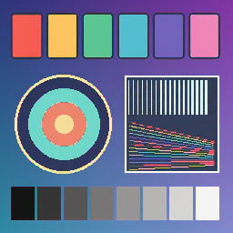 |
| [`sparse_normal`](examples/demo_results/sparse_normal/run.json), normal |  | 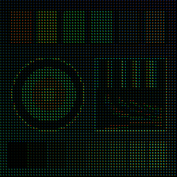 | 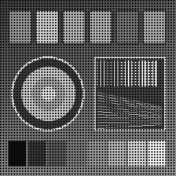 |  |
| [`bayer_mixed`](examples/demo_results/bayer_mixed/run.json), 1/40 |  | 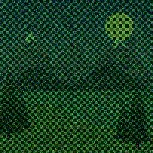 | — | 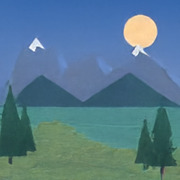 |
| [`sparse_mixed`](examples/demo_results/sparse_mixed/run.json), 1/40 |  | 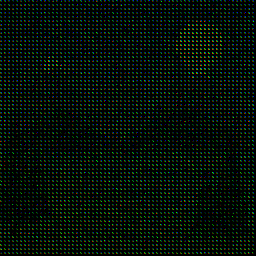 | 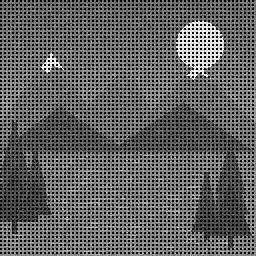 |  |

The simulation outputs before display gain show why the CFA previews are brightened. Sparse RGB and W previews show only their respective sampled sites.

| Bayer simulated RGB | Sparse simulated RGB | Sparse simulated W |
|---|---|---|
| 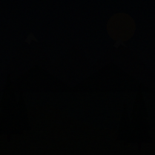 | 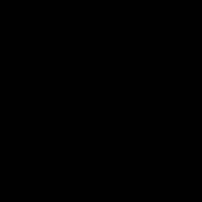 | 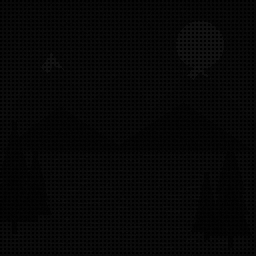 |

The per-model [example output folders](examples/demo_results/) also contain the mask PNGs and metadata. Run the commands to regenerate the lossless arrays; those arrays are not checked into Git.

## Benchmark

Put your 8-bit sRGB images in a directory such as `photos/` and run either command with the matching weights. Bayer and Sparse both generate observations from RGB; neither needs the training dataset, an Arrow cache, a prepared manifest, or precomputed CFA/W images. Sparse uses the same Lab L simulation as `demo`. This evaluates simulated observations, not real camera RAW or the previous cached-observation protocol.

```bash
python -m pipelines benchmark --input-dir photos --model bayer_normal --weights weights/bayer_normal/model.safetensors --device cuda:0 --precision bf16 --output outputs/benchmark-bayer
python -m pipelines benchmark --input-dir photos --model sparse_normal --weights weights/sparse_normal/model.safetensors --device cuda:0 --precision bf16 --output outputs/benchmark-sparse
```

Use `--input-dir examples/samples` to try the bundled images. The command searches subdirectories for PNG, JPEG, BMP, TIFF and WebP files, applies EXIF orientation, and takes non-overlapping 256×256 patches from the top left. Incomplete edges are dropped; at least one full patch is required. The output must be a new directory **outside** the input tree.

Omit `--device cuda:0 --precision bf16` for CPU/FP32. For simulated low light, use the matching mixed checkpoint and add a level such as `--light-level 1/40`. The defaults are normal light, 30 Euler steps and seed 42.

`ground_truth/` holds the original RGB crops and `predictions/` holds the corresponding restorations. The generated `manifest.json` identifies the inputs and marks the observations as `rgb-simulated`. `metrics.json` reports per-patch and aggregate RGB PSNR, SSIM and FSIMc against the original crops. Add `--no-fsimc` to compute just PSNR and SSIM.

## Training

The training dataset is [Funct1ons/Flickr2K_cfa](https://huggingface.co/datasets/Funct1ons/Flickr2K_cfa), a processed derivative of Flickr2K. The launcher can fetch it through Hugging Face Datasets or use an existing cache. Bayer generates GBRG samples online from `image`; Sparse uses aligned `image`, `cfa`, and `cfa_w` patches. The code license does not cover the underlying images or dataset; consult the original sources and applicable terms before redistribution.

For training, use the 256px JiT-B/16 checkpoint from the [JiT project](https://github.com/LTH14/JiT#evaluation):

```bash
python -m training.launch --config training/configs/bayer_normal.json --pretrained_checkpoint PATH_TO_JIT_CHECKPOINT
```

Use a different recipe in `training/configs/` to switch CFA or training illumination. The recipes are starting points: add `--lowlight_prob 0.8 --num_epochs 80` to the Bayer mixed recipe or `--lowlight_prob 0.8` to the Sparse mixed recipe to match the corresponding released training settings. `--dry-run` prints the resolved training arguments without starting training.

Internal manifest-based evaluation tools remain under `training/evaluation/`; they are not required for the RGB-only `benchmark` above.

## License and credits

Code: [MIT](LICENSE). Model weights and training data are not covered by the code license.

Backbone: [JiT](https://github.com/LTH14/JiT). See [third-party notices](THIRD_PARTY_NOTICES.md).
